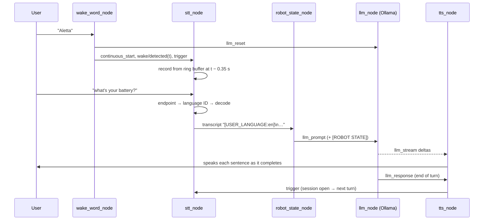

# unitree_converse

Offline voice conversation for the **Unitree G1** humanoid ("Aletta"). Everything
runs on the robot's Jetson Orin NX: wake word, speech recognition, LLM and speech
synthesis, in English and Polish. No cloud service is involved; the robot works
without internet.

- **Say "Aletta"**: opens a conversation session. Turns chain automatically until
  you press START, 4 turns in a row produce no transcript, or 5 minutes pass.
  Inside a session you don't need to say "Aletta" again; if you do, the name is
  cut off the recording (see [Cutting the name](#2-cutting-the-name-off-a-turn)).
- **F1, robot online** (Unitree GPT answering): **press to switch to Aletta**
  on the Jetson ("Switching to Aletta, one moment, please." … ~5 s while the
  LLM loads … "Aletta is ready. How can I help you?", then just talk). Aletta
  stays until the next **F1 press, which switches back to the Unitree GPT**
  (~3 s plus a few seconds of its own start-up). Presses during a switch are
  answered with "Still switching, please wait."
- **Hold F1, robot offline**: push-to-talk for a single turn.
- **START**: ends the session. Only "Aletta" can open one.
- **F3** (labelled F2 on the pad): mutes or unmutes the spoken replies.
- **SELECT**: speaks the fixed `custom_say_text` introduction.

Contents: [Stack](#hardware-and-software-stack) ·
[How it works](#how-it-works) · [Configuration](#configuration) ·
[Setup](#setup) · [Running](#running) · [Wake word](#wake-word) ·
[Development history](#development-history) · [Known issues](#known-issues) ·
[Future work](#future-work) · [Networking](#networking)

---

## Hardware and software stack

| Layer | Component | Notes |
|-------|-----------|-------|
| Computer | Jetson Orin NX 16 GB (inside the G1), JetPack 5, Ubuntu 20.04 | GPU shared by Whisper and the LLM; about 11 of 15 GB RAM in use when everything is loaded |
| Middleware | ROS 2 Foxy, CycloneDDS (`rmw_cyclonedds_cpp`), `ROS_DOMAIN_ID=0` | DDS bound to the robot IP `192.168.123.164` |
| Microphone | G1 head mic array via the audio board `192.168.123.161` | UDP multicast `239.168.123.161:5555`, 16 kHz mono int16, ~160 ms packets, hardware echo suppression |
| Speaker | G1 speaker via Unitree AudioHub `PlayStream` (`unitree_sdk2py`) | 16 kHz mono s16le |
| Wake word | [openWakeWord](https://github.com/dscripka/openWakeWord) 0.6 with a custom "Aletta" ONNX classifier | CPU, 80 ms frames |
| Speech recognition | [faster-whisper](https://github.com/SYSTRAN/faster-whisper) `medium` (int8_float16) for transcription, `small` (float16) for language ID, on CUDA | CTranslate2 built from source with CUDA; no CPU fallback |
| Language model | [Ollama](https://ollama.com) serving `llama3.2` (3B) through [bob_llm](https://github.com/bob-ros2/bob_llm) (OpenAI-compatible API, streaming) | Kept resident (`OLLAMA_KEEP_ALIVE=-1`), 2048-token context |
| Speech synthesis | [Piper](https://github.com/rhasspy/piper) standalone binary, voices `en_US-lessac-medium` and `pl_PL-gosia-medium` | One persistent process per voice |
| Process supervision | systemd: `ollama.service`, `unitree_converse.service`, `wifi-watchdog.service` | Restart forever, start gates for network and model files |

---

## How it works

### Architecture


```
G1 mic (UDP multicast 239.168.123.161:5555, 16 kHz int16, 160 ms packets)
  ├─ wake_word_node   openWakeWord "Aletta" ──── /g1/voice/trigger, /g1/wake/detected,
  │                                              /g1/voice/continuous_start|stop, llm_reset
  └─ stt_node         faster-whisper medium+small (GPU) ── /g1/stt/transcript  "[USER_LANGUAGE:xx]\n<text>"
robot_state_node      + battery/IMU/network ──── llm_prompt
llm_node (bob_llm)    Ollama llama3.2 3B ─────── llm_stream (deltas), llm_response (final)
tts_node              Piper ── g1_audio_worker ── AudioHub PlayStream ── G1 speaker
button_trigger_node   /wirelesscontroller ────── trigger / stop_recording / continuous_stop / speak_enable / say_text
assistant_mode_node   /public_network_status, /gpt_state ── chat_go on/off, /g1/voice/assistant_mode
```

Both `wake_word_node` and `stt_node` open their own socket on the same multicast
group (`SO_REUSEADDR`), so each receives every mic packet independently.
Nodes are started by [voice_real.launch.py](src/g1_voice/launch/voice_real.launch.py)
(robot) or `voice_sim.launch.py` (dev machine, local sound card), with a
`log_level` launch argument.

### Topics

| Topic | Type | Publisher → subscribers | Meaning |
|-------|------|-------------------------|---------|
| `/g1/voice/trigger` | Bool | wake word, F1, tts_node (next turn), stt watchdog → stt | Record one turn |
| `/g1/voice/stop_recording` | Bool | F1 release → stt | End the recording now |
| `/g1/voice/continuous_start` / `_stop` | Bool | wake word, START → stt, tts, wake word | Session opened / closed |
| `/g1/wake/detected` | Float64 | wake word → stt | Wall-clock time of a detection (turn start, or name cut) |
| `/g1/wake/session_state` | String | wake word | `open` / `closed` |
| `/g1/stt/status` | String | stt → wake word | `recording`, `transcribing`, `empty_turn`, `idle` |
| `/g1/stt/transcript` | String | stt → robot_state, tts, wake word | `"[USER_LANGUAGE:en]\n<text>"` |
| `llm_prompt` | String | robot_state → llm_node | Transcript plus `[ROBOT STATE]` block and reply-language instruction |
| `llm_reset` | Bool | wake word → llm_node | Clear chat history (new session) |
| `llm_stream` | String | llm_node → tts | Reply deltas as they are generated |
| `llm_response` | String | llm_node → tts, stt, wake word | Final reply (ends the turn) |
| `/g1/tts/status` | String | tts → stt, wake word | `speaking` / `idle` (echo guard) |
| `/g1/voice/say_text` | String | SELECT, manual → tts | Speak exact text |
| `/g1/voice/speak_enable` | Bool | F3 → tts | Mute / unmute |
| `/g1/robot_state` | String | robot_state | State block, every 30 s (diagnostics) |
| `/g1/voice/assistant_mode` | String (latched) | assistant_mode → stt, wake word | `aletta` / `unitree`: who answers |
| `/public_network_status`, `/gpt_state` | String | robot → assistant_mode | Robot internet state; Unitree assistant heartbeat |
| `/api/robot_state/request` | unitree_api/Request | assistant_mode → robot | `ServiceSwitch` for `chat_go` |
| `/audio_msg` | String | G1 audio board → stt, wake word | `{"play_state": 0}` / `1`: speaker state (echo guard); its ASR results are ignored |

The language marker `[USER_LANGUAGE:pl|en]` is added by `stt_node` and travels
with the text: `robot_state_node` turns it into an instruction for the LLM, and
`tts_node` uses it to pick the Piper voice.

### A turn, step by step



#### 1. Trigger and recording (`stt_node`)

- A trigger arrives from the wake word, F1, the end of the previous reply
  (in a session), or the 20 s watchdog (a reply that never came).
- `stt_node` first waits out the **echo guard** (`logic.EchoGuard`): never
  record while the G1 speaker plays or within 2.5 s after it, so the robot
  doesn't transcribe itself. Playback is known from our `/g1/tts/status` *and*
  from the audio board's `{"play_state": 0|1}` on `/audio_msg`, which also
  covers Unitree's built-in assistant (see
  [Unitree's built-in assistant](#unitrees-built-in-assistant)). A
  "playing" report expires after 60 s, so a lost "stopped" message can't
  mute the mic forever.
- **The answer's start is kept anyway.** People answer as soon as the robot
  stops, during the echo guard. The G1 mic's echo suppression leaves only a
  faint tail (≤ 420 int16 RMS, measured) 0.1 s after the speaker stops, so a
  turn that follows playback takes its audio from the ring buffer starting
  `echo_tail_sec` (0.3 s) after the speaker stopped. Before this, 8 of 11
  recorded turns began mid-sentence and Whisper invented the rest.
- A background thread keeps the last 4 s of mic audio in a **ring buffer**. A
  turn opened by the wake word starts in that buffer 1.5 s before the
  detection (`wake_audio_offset_sec`; the detector fires 0.3–1.0 s after the
  word, later when people don't pause), so "Aletta, what's your battery?"
  works in one breath; the name is then cut at the pause after it (below).
- The **endpointer** (`logic.Endpointer`) decides when the turn ends, from
  per-packet RMS smoothed with a 5-packet median:
  - speech starts after 0.2 s above `speech_start_threshold` (0.02 ≈ 655
    int16 RMS: room ~150, the robot's echo tail ≤ 420, a person talking to
    the robot 1,000–4,200), so noise, a click or the echo can't start a turn;
  - once started, anything above `silence_threshold` (0.010) still counts as
    speech, so quiet word endings aren't cut;
  - with no speech for 8 s the turn is empty;
  - after speech it ends on 1.2 s of trailing silence, on F1 release, or 10 s
    after you **started** talking;
  - the clip keeps 1 s from before the onset.

#### 2. Cutting the name off a turn

Inside a session people say "Aletta" again before each question, while a turn is
already recording. Whisper mishears the name and merges it into the question
("Aletta, what is two times two" → "All that for both is two times two"; a lone
"Aletta" → "stream."). `wake_word_node` therefore reports detections made during
a recording on `/g1/wake/detected`, and `stt_node` cuts the audio
(`logic.name_cut`):

- the wake model scores one "Aletta" twice, ~1.1–1.3 s apart (its window
  still holds the word after a reset), so `wake_word_node` ignores hits within
  `refractory_sec` (1.5 s) of the last one, and `stt_node` never treats a
  detection within 1.5 s of the turn-starting one as a new name. Before this
  fix the repeat was taken as the name and the cut removed the start of the
  question ("[ile to je]st 2 razy…");
- only the first detection inside the recording counts, and only if it falls
  within `wake_trim_max_sec` (1.5 s) of the speech onset; a later detection is
  the model misfiring on the question itself;
- the cut is placed `wake_trim_offset_sec` (0.2 s) before the detection, which
  lands in the pause after the name (the detector lag varies 0.27–0.6 s);
- the cut is then moved back to the end of a real pause (≥ 100 ms below
  `silence_threshold`, `logic.snap_cut_to_pause`), or not made at all: when
  people don't pause, the score peaks up to ~1 s after the name, inside the
  question (all 4 cuts in the second live test landed in speech). Keeping the
  name costs a misheard word; cutting into the question loses the question;
- if no speech is left (`logic.has_speech`), the turn is dropped without a
  Whisper pass ("Only the name was said") and listening resumes immediately.

#### 3. Language and transcription (`logic.choose_transcription`)

- **Vocabulary hint:** English decodes get a Whisper `initial_prompt` of
  robot/lab words (Aletta, Unitree G1, battery, ROS 2, nodes, …; words only,
  never example questions). A transcript that only repeats the hint is
  dropped (`logic.echoes_prompt`). Polish has no hint by default (it fixed
  nothing on recorded Polish turns and once echoed itself).
- **Model choice**, measured on 5 clean recorded questions (name cut, speaker
  ~1 m away):

  | Setup | Language ID + decode | Right |
  |-------|----------------------|-------|
  | `small` | 0.47 + 0.67 s | 1 / 5 |
  | `small` + hint | 0.47 + 0.67 s | ~1.5 / 5 |
  | `medium` int8 + hint | 1.25 + 1.6 s | 4 / 5 |
  | `medium` int8 + hint, `language_id_model: small` | 0.47 + 1.6 s | 4 / 5 |
  | `large-v3-turbo` int8 | – + 2.2 s | 1 / 5 |

  The robot runs the last `medium` row (`model_size: "medium"`, `compute_type:
  "int8_float16"`, `language_id_model: "small"`): both models load in ~12 s,
  RAM stays ~10.6 of 15.4 GB. To go back to `small` alone set `model_size:
  "small"`, `compute_type: ""`, `language_id_model: ""`.

- One language-ID pass (~0.5 s) gives Whisper's probabilities.
  `logic.pick_language` accepts English when p(en) ≥ 0.25 and ≥ 10× p(pl), and
  Polish when p(pl) ≥ 0.2 and ≥ 2× p(en). The rules are asymmetric because
  Whisper detects English reliably on this mic but scores short Polish phrases
  as hi/zh/en.
- Then one decode (~0.7 s, beam 5, temperature 0, Silero VAD filter) in that
  language. If the language is unclear, the language of the previous turn in
  the session is used; only when there is none are both languages decoded and
  the better-scoring non-hallucination wins.
- Filters (`logic.keep_segment`), tuned on recorded G1 turns:
  - `no_speech_prob` > 0.85: dropped;
  - `avg_logprob` < −1.0 (`min_avg_logprob`): dropped. Real turns decoded at
    −0.66 to −0.88, invented ones ("God bless you all, God bless you all") at
    −1.01 to −1.22;
  - `no_speech_prob` > 0.5 *and* `avg_logprob` < −0.7 (Whisper's combined
    rule, `noisy_*`): dropped. Distant talk and noise ("That's the end of the
    episode…") scored 0.58–0.65 / −0.79 to −0.93, real turns 0.04–0.27;
  - `logic.looks_like_noise` rejects phrase loops, non-Latin script and
    subtitle phrases ("Thanks for watching", "see you in the next video");
  - a transcript that is only the name is ignored.

  Replayed on 23 recorded turns (21 had reached the LLM): 7 no longer start a
  turn, 10 are dropped, 4 pass, the real questions among them.
- The result is published with the language marker; `STT timing:` logs the
  end-of-speech wait, language-ID and decode times.

#### 4. Prompt and reply (`robot_state_node`, `llm_node`)

- `robot_state_node` prepends a short `[ROBOT STATE]` block (battery %,
  charging, health, orientation, motion mode, network, local time, uptime)
  and an instruction to answer in the user's language. When the user asks
  about the software (`logic.asks_about_system`: nodes, topics, parameters,
  settings, models, thresholds, modes…) it adds the ROS graph, the assistant
  mode, key settings and **every parameter whose name matches the question**
  (`logic.match_parameters`). It lists and reads *all* parameters of the
  pipeline nodes (about 100) through their ROS parameter services every 30 s.
  Read-only by design: nothing is changed by voice.
- `llm_node` (bob_llm submodule) sends the system prompt plus the prompt to
  Ollama and streams the reply. With `max_history_length: 1` each question is
  answered on its own (see [Known issues](#known-issues)); `llm_reset` clears
  the history at every new session. A stream error is never spoken or stored.
- The system prompt ([voice_params_real.yaml](src/g1_voice/config/voice_params_real.yaml))
  asks for one or two short spoken sentences, to ask for a repeat when the
  input makes no sense, and never to claim a physical action.

#### 5. Speech output (`tts_node`, `g1_audio_worker`)

- Every transcript opens a **pending turn** in a FIFO. bob_llm answers prompts
  in order, so stream deltas and the final response always belong to the
  oldest pending turn; an interrupted turn can't steal the next reply.
- Text is split into complete sentences as it streams in
  (`logic.split_complete_sentences`); the first piece may end at a comma once
  it has 5 words (`first_clause_words`), so speech starts sooner.
- A synthesis thread feeds each sentence to a **persistent Piper process**
  (`--json-input`, one per voice, warmed up at start; 0.1–0.5 s per sentence),
  resamples 22.05 kHz → 16 kHz (polyphase), and queues it; a playback thread
  plays the previous sentence meanwhile.
- Playback goes through `g1_audio_worker.py`, a **separate process** that owns
  `unitree_sdk2py` (it brings its own DDS participant) and speaks a one-line
  JSON protocol over stdin/stdout. Playback has a timeout of 15 s + 2× the
  audio length; after a failure the rest of the reply is skipped and the
  worker restarts.
- When the reply ends during a session, `tts_node` triggers the next turn.
  `Reply timing:` logs transcript → first token and → first audio.

### The session state machine

`logic.Session` (owned by `wake_word_node`) tracks one conversation window:

- **Opens** on a detection when no session is open, the pipeline is idle and the
  cooldown has passed. Opening publishes `llm_reset`, `continuous_start`, the
  detection time and a trigger.
- **During a session** a detection while idle starts a new turn; a detection
  while recording is forwarded for the name cut; otherwise it is ignored.
- The state is published latched on `/g1/wake/session_state`, so `stt_node`
  and `tts_node` join a session that opened before they were ready (at boot a
  session once opened 1 s before STT, which then never re-listened by itself).
- **Closes** on START, after 4 consecutive empty turns, or after 300 s
  (deferred while a turn is in flight).
- **False-accept backoff:** a session that produced no transcript multiplies
  the re-open cooldown by 1.5 (4 s base, capped at 30 s); a real transcript
  resets it.
- Busy flags (`stt`, `reply`, `tts`) expire after 60 s, so a lost status
  message can never wedge the session.

### Latency

Measured on the robot (journal of 21 Nov 2026):

| Stage | Time |
|-------|------|
| End-of-speech wait (trailing silence) | 1.28 s |
| Language ID | 0.50–0.54 s |
| Whisper decode | 0.67–0.74 s |
| LLM first token after transcript | 0.30–0.68 s |
| First audio after transcript | 0.60–1.75 s |
| **End of speech → robot starts talking** | **≈ 3–4 s** |

About 40 % of that is the fixed end-of-speech wait; see [Future work](#future-work).

### Processes, threads and failure handling

- **One worker thread per STT turn loop.** `idle` is always published, even
  if a turn throws, so the session never waits on a dead turn.
- **Mic threads** in `stt_node` and `wake_word_node` reconnect the multicast
  socket on errors (logged at most every 30 s).
- **Wake word without its model:** wake stays disabled (logged) and the pad
  buttons still work.
- **LLM:** retries only while nothing has been published; a failed turn still
  publishes an (empty) response so the session continues.
- **systemd:** `unitree_converse.service` waits for the robot network and
  checks that the config, Piper binary and both voices exist, then restarts
  forever (10 s delay). `ollama.service` keeps the model loaded and is
  protected from the OOM killer.

### Code layout (`src/g1_voice/g1_voice/`)

| File | Role |
|------|------|
| `logic.py` | ROS-free logic: language markers, sentence splitting, Whisper filters and the language duel, `Endpointer`, `name_cut` / `has_speech`, the `Session` state machine, system summaries, finding the robot network by IP. Fully unit-tested. |
| `wake_word_node.py` | Feeds every 80 ms mic frame to openWakeWord, applies the loudness and echo gates, runs the session. |
| `wake_word_openwakeword.py` | Thin openWakeWord wrapper (deferred import, consecutive-frame confirmation). |
| `stt_node.py` | Ring buffer, one worker thread with one turn per trigger, name cut, Whisper. Can save each turn to `debug_audio_dir`. |
| `tts_node.py` | Turn queue, persistent Piper process per voice, resampling, `AudioPlayer` with timeouts. |
| `g1_audio_worker.py` | Separate process for `AudioClient.PlayStream`. |
| `robot_state_node.py` | Builds the `[ROBOT STATE]` block. |
| `button_trigger_node.py` | Pad bitfield to actions. |
| `assistant_mode_node.py` | Aletta vs. Unitree's GPT assistant: switches `chat_go` and publishes the mode. |

Other parts of the repository:

| Path | Contents |
|------|----------|
| `src/bob_llm/` | Submodule: ROS 2 LLM node (fork with `llm_reset`, stream retry policy, bounded history) |
| `src/wakeword_training/` | Submodule: "Aletta" data, training and evaluation scripts, models |
| `scripts/` | Health checks (`check_audio.sh`, `check_pipeline.sh`), benchmarks (`bench_stt.py`, `bench_llm.py`, `bench_whisper_gpu.py`), `test_mic_live.py`, Wi-Fi watchdog, service start gate, links to the wake-word scripts |
| `setup.sh`, `source_ros.sh` | Installation and environment |
| `*.service` | systemd units |

---

## Configuration

All tunables are in [config/voice_params_real.yaml](src/g1_voice/config/voice_params_real.yaml)
(robot) and `config/voice_params.yaml` (dev machine). Each key is commented;
node defaults live in the source. The most important ones:

| Node | Parameter | Value | Effect |
|------|-----------|-------|--------|
| llm_node | `api_model`, `temperature`, `max_tokens` | llama3.2, 0.4, 90 | Model and reply length |
| llm_node | `max_history_length` | 1 | Earlier turns sent to the LLM (0 = unlimited) |
| stt_node | `model_size`, `compute_type`, `language_id_model` | medium, int8_float16, small | Whisper models (transcription, language ID) |
| stt_node | `language` | auto | Or `en` / `pl` to skip language ID |
| stt_node | `speech_start_threshold` | 0.02 | RMS needed to start a turn |
| stt_node | `silence_threshold` | 0.010 | RMS that still counts as speech once started |
| stt_node | `min_avg_logprob`, `noisy_no_speech_prob`, `noisy_min_avg_logprob` | −1.0, 0.5, −0.7 | Confidence filters for Whisper segments |
| stt_node | `echo_tail_sec` | 0.3 | A turn after playback starts this long after the speaker stopped |
| stt_node | `silence_duration` | 1.2 | Trailing silence that ends a turn (s) |
| stt_node | `max_wait_for_speech`, `recording_duration` | 8, 10 | Empty-turn timeout; max utterance (s) |
| stt_node | `wake_audio_offset_sec` | 0.35 | Wake turn starts this long before the detection |
| stt_node | `wake_trim_offset_sec`, `wake_trim_max_sec` | 0.2, 1.5 | Name cut (see above) |
| stt_node | `tts_echo_guard_sec` | 2.5 | No recording within this of speaker playback |
| stt_node, wake_word_node | `board_play_state_topic` | /audio_msg | Audio board speaker state for the echo guard (`""` = our TTS only) |
| stt_node | `debug_audio_dir` | /tmp/stt_turns | Save each turn (`""` = off) |
| wake_word_node | `aletta_threshold`, `min_consecutive_frames` | 0.8, 2 | Detection sensitivity |
| wake_word_node | `min_rms`, `energy_window_sec` | 400, 2.0 | Loudness gate |
| wake_word_node | `max_empty_turns`, `session_max_duration_sec` | 4, 300 | Session limits |
| tts_node | `length_scale`, `first_clause_words` | 0.8, 5 | Speaking rate; early first clause |
| button_trigger_node | `custom_say_text` | introduction | SELECT phrase |
| assistant_mode_node | `unitree_assistant`, `unload_llm_online` | auto, true | `off` / `auto` / `leave`; unload Ollama while Unitree answers (see [Unitree's built-in assistant](#unitrees-built-in-assistant)) |
| wake_word_node | `takeover_from_unitree` | false | Let "Aletta" interrupt the Unitree GPT while online |

Environment overrides for running next to other GPU-heavy software:
`STT_DEVICE=cpu` (CPU Whisper, explicit opt-in) and `TTS_MODE=python`. The
`LLM_NGL` variable mentioned in the YAML comments is not read by any node;
to keep the LLM off the GPU, configure Ollama instead.

---

## Setup

```bash
git clone --recursive https://github.com/PiotrG1996/unitree_converse.git
cd unitree_converse
./setup.sh robot     # or: ./setup.sh dev
```

`setup.sh` does the following:

- installs Python packages, the Piper voices (en_US-lessac, pl_PL-gosia),
  Whisper `small` and the openWakeWord models;
- on the robot, installs the Piper binary to `~/.local/piper-bin`;
- installs Ollama with the tuned [ollama.service](ollama.service) and pulls
  `llama3.2`;
- builds with `colcon build --symlink-install`;
- on the robot, installs and enables [unitree_converse.service](unitree_converse.service).

Two steps stay manual: Wi-Fi (`sudo ./scripts/install_wifi_watchdog.sh`, see
[Wi-Fi](#wi-fi)) and pinning the robot network port (see
[Robot network port](#robot-network-port)). `~/cyclonedds_ws/cyclonedds.xml` must
bind `<NetworkInterface address="192.168.123.164" .../>`.

**GPU Whisper on the Jetson:** the pip `ctranslate2` wheel has no CUDA library.
Build CTranslate2 with CUDA and install it to `~/ct2_install` (or set
`CTRANSLATE2_LIB_DIR`). `stt_node` preloads `libctranslate2.so.4` from there
with `RTLD_LOCAL`, because `RTLD_GLOBAL` corrupts the heap inside the ROS
process. There is deliberately no CPU fallback.

**Builds are symlinked** (`colcon_defaults.yaml`), so YAML and Python edits
take effect when you restart the service. Rebuild only after adding files or
entry points.

## Running

```bash
sudo systemctl restart unitree_converse      # after any change
journalctl -u unitree_converse -f

# manual run: stop the service first (both would share the mic and the topics)
sudo systemctl stop unitree_converse
source source_ros.sh
ros2 launch g1_voice voice_real.launch.py log_level:=DEBUG
```

A healthy turn in the journal looks like this:

```
[wake_word_node]: Session OPEN (Aletta 0.96)
[stt_node]: Language pl (en=0.01 pl=0.89)
[stt_node]: STT timing: end-of-speech wait 1.28s, language ID 0.54s, decode 0.73s
[stt_node]: Transcript [pl]: "Ile to jest 2 razy 3?"
[llm_node]: Processing prompt...
[tts_node]: Reply timing: first token 0.30s, first audio 0.60s after transcript
[tts_node]: Spoke [pl] 1.21s (synth 0.20s): "To jest 6."
```

Testing without speaking to the robot:

```bash
ros2 topic pub --once /g1/stt/transcript std_msgs/msg/String "data: \"[USER_LANGUAGE:en]\nWhat is your battery level?\""
ros2 topic pub --once /g1/voice/say_text std_msgs/msg/String "data: 'Hello! I am Aletta.'"
ros2 topic pub --once /g1/voice/trigger std_msgs/msg/Bool "data: true"   # record one turn
```

Audio played through the robot's own speaker is **not** a valid microphone test:
the G1 mic's echo suppression mutes it within about 0.3 s. Test STT with a real
voice.

Checks and tests:

```bash
./scripts/check_audio.sh            # mic multicast + speaker
./scripts/check_pipeline.sh         # Ollama, Piper, Whisper (ROS_FULL=1 also probes topics)
cd src/g1_voice && python3 -m pytest -q --ignore=test/test_llm_pipeline.py   # unit tests + lint
python3 -m pytest -q test/test_llm_pipeline.py                               # needs Ollama/Piper
python3 scripts/bench_stt.py small ~/models/faster-whisper-large-v3-turbo:int8_float16
```

### Debugging speech recognition

With `debug_audio_dir: "/tmp/stt_turns"` (the default in `voice_params_real.yaml`),
`stt_node` saves every turn as `<time>.wav` plus `<time>.txt`, keeping the last
50. The text file holds:

- verdict (published, empty or hallucination);
- language;
- loudness per 100 ms;
- each Whisper segment with its no-speech and confidence scores.

Set `debug_audio_dir: ""` to turn it off. The recordings contain people's
voices; don't copy them off the robot without consent.

Reference levels on the G1 mic (int16 RMS): quiet room about 170 (99th
percentile about 350), a person talking nearby 3000–4500, the robot's own
speaker as heard by its mic 1100–1500, before the echo suppression mutes it.

---

## Wake word

The "Aletta" model is a custom openWakeWord model. openWakeWord computes a
melspectrogram and a shared speech embedding for every 80 ms frame; a small
classifier scores the last ~1.3 s of embeddings. The score therefore peaks
about 1 s *after* the word.

Training data, scripts and models are in the
[`src/wakeword_training`](src/wakeword_training) submodule: synthesize clips with
Piper, **record real positives and negatives** on the robot, train, then
evaluate on real clips before you deploy. `setup.sh` copies
`models/aletta_v0.1.onnx` to `~/.local/share/openwakeword/`.

Runtime guards (all in the YAML):

- **`aletta_threshold`** and **`min_consecutive_frames`**: a detection needs
  N consecutive 80 ms frames above the threshold.
- **`min_rms`** and **`energy_window_sec`**: the loudest frame of the last 2 s
  must reach this RMS. Because the score peaks after the word, when the room is
  quiet again, the gate looks back instead of at the current frame. The
  threshold of 400 sits just above the quiet room (99th percentile about 350).
- **`echo_guard_sec`** (1.5 s): detections are ignored while the speaker plays
  (our TTS or the audio board's `play_state`) and for this long afterwards.
  1.5 s covers the model's ~1.3 s window (so the robot's own last words can't
  trigger it) but lets "Aletta" said right after a reply be detected and cut
  from the turn.
- **False-accept backoff**: see [the session state machine](#the-session-state-machine).

If the model or the `openwakeword` package is missing, wake stays off (logged)
and the pad buttons still work.

### Unitree's built-in assistant

The G1 ships with its own cloud voice assistant, independent of this project:
the robot service **`chat_go`** (Unitree's "GPT"), running on the robot's
internal computer. It listens to the same microphone and answers in a male
English voice, so with both running a question can get two answers ("male
voice, then female voice"). `assistant_mode_node` decides who answers.

**Policy** (`unitree_assistant` in `voice_params_real.yaml`):

| Value | Who answers | What happens to `chat_go` |
|-------|-------------|---------------------------|
| `off` | Aletta | Switched off at start and kept off |
| `auto` (robot config) | **Robot on Wi-Fi:** only the official Unitree GPT (English: its ASR, cloud GPT and voice through `audio_player_service`, all on the robot's own computer); "Aletta" is ignored. **Offline:** Aletta on the Jetson | On while online, off when offline |
| `leave` | Aletta | Never touched; both may answer |

How it works:

- **Switching:** the robot's service manager (`robot_state` service,
  `ServiceSwitch`, api 1001, `{"name": "chat_go", "switch": 0|1}`), sent as
  plain ROS messages on `/api/robot_state/request`. Switching off takes
  ~0.1 s, on ~3 s. The service list keeps reporting status 0 either way, so
  the node judges by `/gpt_state`, which `chat_go` publishes every ~5 s
  (`{"state": true, "llm_name": "clound", "chat_state": …}`).
- **Internet:** the robot's own `/public_network_status`
  (`{"network_status": "NetworkStatus.ON_WIFI_CONNECTED"}`); any
  `…_CONNECTED` counts as online, and no report for 30 s counts as offline.
  While the state is undecided (just started, just came online) nothing is
  switched, so the service is never turned off and straight back on.
- **Handover:** the mode is published latched on `/g1/voice/assistant_mode`
  (`aletta` / `unitree`). In `unitree` mode `wake_word_node` ignores "Aletta"
  and `stt_node` ignores triggers (including F1), so Aletta stays silent; the
  handover waits for an open Aletta session to close. Going offline hands back
  to Aletta immediately.
- **Who answers** (`auto`): while the robot reports Wi-Fi/internet, only the
  official Unitree GPT (`chat_go` on; start with "Hey, robot"). The Jetson
  pipeline stays idle: "Aletta" and false wakes are ignored
  (`takeover_from_unitree: false`), and Ollama's model is unloaded
  (`unload_llm_online`: frees 2.2 GB in 0.01 s). When the robot goes offline,
  `chat_go` is switched off, the model is loaded again (5 s) and Aletta
  answers. Whisper stays loaded, so the switch is immediate.
- **F1 switch** (online): `button_trigger_node` sends `/g1/voice/assistant_toggle`
  while `/g1/voice/assistant_online` (latched) is true; `assistant_mode_node`
  then forces Aletta (`chat_go` off, LLM loaded, "ready" announced, session
  opened via `/g1/voice/session_request`) or returns to Unitree (Aletta's
  session closed, `chat_go` on, LLM unloaded). Going offline clears the F1
  choice; back online, Unitree is the default again.
- **Optional takeover** (`takeover_from_unitree: true` in `wake_word_node`):
  "Aletta" opens an Aletta session even online; `chat_go` is switched off
  (~0.1 s) until the session closes, then on again (~3 s; say "Hey, robot"
  again, its conversation restarts).
- **How Unitree's GPT works** (recorded 21 Nov): it reacted to "Hey, robot, …"
  and then answered every follow-up without the phrase ("Hey, tell me what
  time is it" alone got no reaction), so it seems to have its own wake phrase
  and conversation mode. For each question a Unitree process sends the
  recorded speech to `chat_go` (`/api/gpt/request`, api 1018, MP3 in base64:
  "speech request success"); `chat_go` sends body-language commands on
  `/gpt_cmd` and plays the answer as app `gpt` (`PlayStream`). The node logs
  `Unitree GPT: question received (… kB of speech)` for each question.
- **`chat_state` is not an on/off switch:** it went `false` at 18:16:14 while
  `chat_go` went on answering six questions, so it is ignored. `"state":
  false, "llm_name": "no"` also appears for ~5 s every ~33 s (cloud
  reconnects).
- **Manual control** (outside the pipeline):

  ```bash
  ros2 run g1_voice assistant_mode_node --ros-args -p unitree_assistant:=auto   # or off
  ```

What else was measured (passive DDS monitor, 21 Nov 2026):

- Unitree's offline ASR transcribes everything the mic hears, without a wake
  word, on `/audio_msg` (`{"text": …, "language": "<|ja|>", …}`), guessing
  freely between languages: Polish "Aletta" came out as Japanese "アレさん。".
  This project never uses these results; its own language set is fixed to
  Polish and English (`logic.LANGUAGES`).
- `chat_go` speaks by sending `PlayStream` audio as app **`gpt`**. In the
  recorded case it started 0.1 s after our transcript and was cut off when
  Aletta's reply started.
- What does **not** work: `VuiClient.SetSwitch` (not implemented on the G1,
  error 3104) and muting the `vui` volume (it is the same master volume as
  AudioHub, so it mutes Aletta too).
- `AudioClient.TtsMaker(text, speaker_id)` (Unitree's built-in TTS) works:
  speech starts 0.2–0.5 s after the call and calls queue, but there is no
  Polish voice, and the Python SDK never changes the request `index`, so
  every call after the first is ignored unless the index is set by hand.

Independently of the policy, the echo guard treats the board's `play_state`
as speaker activity, so if the male voice speaks it can neither start a
session nor be transcribed. `stt_node` logs
`Speaker playing without our TTS (Unitree assistant?)` whenever it happens.
Set `board_play_state_topic: ""` to rely on our TTS status only.

---

## Development history

Compared with the upstream [SaxionMechatronics/unitree_converse](https://github.com/SaxionMechatronics/unitree_converse)
(CPU Whisper, English only, push-to-talk) and with this fork's state before the
November 2026 review. All numbers below were measured on the robot.

**Conversation and speech**

| Area | Before | Now |
|------|--------|-----|
| Speech recognition | Whisper `base` on CPU: about 1.2 s per 5 s clip; misheard "Aletta, what is…" as "A letter…" | Whisper `medium` (int8) with `small` for language ID, on the GPU: about 2.1 s per turn (language ID + decode), 4/5 clean questions right vs 1/5 with `small` alone |
| Question cut off | The 10 s limit started when the turn opened; a question begun 8 s in was cut after 2 s | The 10 s limit starts when you start talking (it waits up to 8 s for you) and keeps 1 s from just before |
| Wake word "Aletta" | Fired 6 s late or not at all: the loudness check looked at the current frame, but the score peaks about 1 s *after* the word | Fires about 1.5 s after the word; the loudness check looks back 2 s |
| Reply speed | Piper restarted for every sentence (0.62 s); first reply took 2.9 s | Piper keeps running (0.1–0.5 s per sentence) and warms up at start; first audio 0.6–1.75 s after the transcript |
| Hallucination filter | ASCII only; a question said twice was dropped; "ご視聴ありがとうございました" reached the LLM | Unicode-aware (Polish); only 3+ repeats count as a Whisper loop; non-Latin text and subtitle phrases ("Thanks for watching", "Amara.org") are dropped |
| Misheard turns derailing answers | A garbled turn ("I na peryski 2x2") stayed in the LLM history, and "ile to jest 2x2?" was then answered with a made-up "2 m × 2 m periscope plate" | Each question is answered on its own (`max_history_length: 1`); bob_llm also resets on every new "Aletta" session (`llm_reset`). The prompt says: ask to repeat when a message is garbled, never claim to have moved. |
| Name garbling in-session questions | "Aletta, what is two times two" became "All that for both is two times two"; a lone "Aletta" became "stream." and got a reply. Detections during a recording were dropped | The name is cut off the turn's audio using the wake detection time; a turn with only the name is dropped |
| Off-topic replies | The prompt carried battery current, temperature and cycles, which the LLM volunteered | Only battery %, charging and health |
| Session bookkeeping | Relied on `/g1/llm/status`, which nothing published, so every session counted as a false wake | Uses transcript → `llm_response`; busy flags expire after 60 s |

**Robustness**

| Area | Before | Now |
|------|--------|-----|
| STT stuck forever | A mic socket error left the recording slot taken, and the session never closed | One worker thread; `idle` is always published, even when a turn fails |
| Replies to the wrong question | Interrupting a turn could attach the old reply to the new question | A queue of pending turns, answered in order |
| Speaker failures | Each failed sentence waited for a 10 s timeout; the SDK's prints corrupted the worker protocol | The rest of a reply is skipped after one failure; the worker keeps stdout to itself |
| LLM failures (bob_llm) | Retries never ran; empty replies stalled the session; history grew without limit | Real retries; a failed turn still publishes an (empty) reply; bounded history |
| Robot network | Everything bound to the name `eth0`, which a USB dongle could take | Everything follows the robot IP `192.168.123.164` |
| Wi-Fi | Not monitored | `wifi-watchdog.service`: checks internet through `wlan0`, reconnects, switches network, resets the radio and reloads the driver |
| Ollama tuning | The tuned unit was never installed and used an ignored variable | Installed by `setup.sh`: model stays loaded, `OLLAMA_CONTEXT_LENGTH=2048`, OOM protection |

**Codebase:** the `g1_voice` code shrank from about 4,400 to about 2,500 lines. The
pure logic lives in `logic.py`; the package has about 95 unit tests plus flake8
and pep257 checks.

---

## Known issues

| Symptom | Cause / fix |
|---------|-------------|
| Follow-ups like "A trzy razy trzy?" get "please repeat" | No earlier turns are sent to the LLM, because misheard turns derailed later answers. Ask complete questions. To allow follow-ups, raise `max_history_length` (each "Aletta" session still starts fresh). |
| A male English voice answers too, before or alongside Aletta | Unitree's built-in assistant (`chat_go`, plays as app `gpt`). With `unitree_assistant: off` (default) `assistant_mode_node` switches it off; check the log for `switched OFF`. See [Unitree's built-in assistant](#unitrees-built-in-assistant). |
| Accented English is misheard ("two times three" → "tool time is free") | Whisper `small` on the far-field mic. `medium` and `large-v3-turbo` were tested on the same recordings: neither was better overall, and both are 4–6× slower (2.7–4.2 s per turn). Polish is recognized well. |
| Aletta wakes on speech that isn't her name | The deployed `aletta_v0.1` does not separate the name from other speech: `eval_real_separation.py` scores real negatives (median 0.993) as high as real positives (gap −0.175, "Do NOT deploy"). It also fires right after some questions. Wake is effectively speech plus the `min_rms` gate and cooldowns. Record more real negatives and retrain. |
| A one-syllable answer ("Tak.") is missed | The endpointer needs 0.2 s of smoothed speech above `speech_start_threshold`; a very short word doesn't reach it. Answer with a few words. |
| A quiet or distant speaker is ignored | A turn needs RMS 0.02 (≈ 655) to start, which keeps noise and distant talk out. Speak within ~1 m, or lower `speech_start_threshold` (at 0.010 noise started turns). |
| Polish answers are sometimes wrong or ungrammatical ("Trzy razy trzy to piętnastu") | llama3.2 3B is weak in Polish. A stronger multilingual or Polish model would help. |
| A pause after "Aletta" splits the question | The turn ends after 1.2 s of silence. The name-only part is dropped and the next turn starts at once, but words said in that gap can be lost. Say the question in one breath. |
| `No microphone audio received`, TTS `PlayStream returned 3102`, `ping 192.168.123.161` fails | The robot IP `192.168.123.164` is on the wrong Ethernet port. Pin the `unitree1` profile to the built-in port by MAC (see [Robot network port](#robot-network-port)). If .161 still doesn't answer, the robot is off. |
| `unregister_netdevice: waiting for eth0 to become free`, `ip addr` hangs | The USB Ethernet dongle dropped off the bus (`r8152 … Tx status -71`) and the kernel can't release it. Only a reboot clears it. Run without the dongle; Wi-Fi provides internet. |
| DDS fails at boot | `cyclonedds.xml` must bind `address="192.168.123.164"`, not an interface name. |
| Battery `unknown` | `BmsState` comes from `unitree_hg` and needs RELIABLE QoS (already set). |
| No SSH over Wi-Fi | AP isolation: use Ethernet (`192.168.123.164`). |

---

## Future work

Ordered by expected benefit for the effort. Each item names how to measure it,
so a change can be accepted or rejected on numbers from the robot.

### Short term: reliability of what exists

1. **Retrain the wake word on real negatives.** v0.1 cannot tell the name from
   other speech. Record a larger set of real negatives on the robot (lab
   conversations, the robot's own voice, Polish speech), retrain, and deploy
   only a model with a positive separation gap in `eval_real_separation.py`.
   Evaluate the v0.2–v0.4 candidates the same way first.
   *Measure:* false wakes per hour of background talk; misses per 100 "Aletta".
2. **Shorter end-of-speech wait.** The fixed 1.2 s silence is about 40 % of the
   response time. Endpoint on the Silero VAD speech probability instead of RMS,
   with a shorter silence after a falling intonation or a complete sentence,
   and keep 1.2 s as the fallback. *Target:* −0.5 s per turn without cutting off
   slow speakers.
3. **Drop the separate language-ID pass.** Lock the language for the rest of a
   session once a turn is confidently identified, or reuse the encoder output
   for detection and decoding. *Target:* −0.5 s on most in-session turns.
4. **Regression tests from real audio.** Turn the `/tmp/stt_turns` recordings
   (with consent) into a fixture set that replays through `Endpointer`,
   `name_cut`, language selection and Whisper, with expected transcripts.
   This makes model or threshold changes measurable instead of anecdotal.
5. **Safe follow-up questions.** Keep a turn in the LLM history only when its
   transcript is trustworthy (Whisper `avg_logprob` and `no_speech_prob`
   above a threshold, not a "please repeat" exchange), then raise
   `max_history_length` to 3. *Measure:* the periscope-style derailments
   must not return on the regression set.

### Medium term: quality of the conversation

6. **English recognition for accented speech.** Fine-tune Whisper `small`
   (or a distilled larger model) on speech recorded through the G1 mic, or
   evaluate `distil-large-v3` int8. Larger stock models were not better on
   the current clips, so data from the target microphone is the likely lever.
   *Measure:* word error rate on the regression set, latency ≤ 1 s.
7. **A stronger multilingual LLM.** Benchmark Qwen 2.5 3B/7B, Gemma, and the
   Polish Bielik models in Ollama with `scripts/bench_llm.py`: Polish grammar,
   arithmetic, refusal of physical actions, first-token latency and memory
   next to Whisper.
8. **Better Polish voice.** `pl_PL-gosia-medium` is intelligible but flat.
   Compare other Piper Polish voices and a newer neural TTS (an initial
   Phonon TTS experiment exists locally) for naturalness at ≤ 0.3 s per
   sentence.
9. **Barge-in.** Let the user interrupt a long reply ("Aletta, stop"). The G1
   mic suppresses the robot's own speaker, which may make wake-word detection
   during playback feasible; needs testing against false stops.
10. **Persona-aware answers.** Retrieval over a small local knowledge base
    (lab, university, current projects) so factual questions about the
    institution are answered from documents, not from the 3B model's memory.

### Long term: embodiment and platform

11. **Actions through tools.** bob_llm supports tool calls. Expose a small,
    safe set of robot behaviours (gestures, head/arm pointing, "look at me")
    with explicit confirmation and a hard allow-list; the system prompt
    currently forbids claiming any physical action.
12. **Speaker localization.** Use the mic array direction of arrival (if the
    audio board exposes it) or the head camera to turn toward the speaker and
    to reject speech from other directions.
13. **ROS 2 Humble.** Foxy is end-of-life. Moving requires a newer JetPack /
    Ubuntu 22.04 on the Orin NX, or running the pipeline in a Humble container
    bridged to the robot's DDS.
14. **Observability.** Publish a structured per-turn record (timings, verdict,
    language, scores) and collect it into a dashboard, so latency and error
    rates can be tracked over days of real use.
15. **Reproducible deployment.** Pin Python dependency versions, script the
    CTranslate2 CUDA build, and provide a container image so a fresh Jetson
    can be set up without manual steps.

---

## Networking

### Robot network port

The Jetson has a built-in port (PCIe `r8169`, MAC `44:bb:47:a2:12:9e`) and may
have a USB Ethernet dongle (`r8152`, MAC `00:e0:4c:68:01:43`). Whichever one
probes first becomes `eth0`, so the robot address is pinned by MAC, not by name:

```bash
sudo nmcli con mod unitree1 connection.interface-name "" 802-3-ethernet.mac-address 44:BB:47:A2:12:9E connection.autoconnect-priority 100
sudo nmcli con mod internet-ethernet connection.interface-name "" 802-3-ethernet.mac-address 00:E0:4C:68:01:43
sudo nmcli con up unitree1
```

`cyclonedds.xml`, `stt_node`/`wake_word_node` (`udp_local_ip`), the AudioHub
worker and `wait_for_robot_ready.sh` all locate the robot network by the IP
`192.168.123.164`, so they don't care which name the port gets.

### Wi-Fi

Wi-Fi works at system level, without any user login. The profiles are
NetworkManager keyfiles in `/etc/NetworkManager/system-connections/`, with the
password stored in the file. The systemd unit `wifi-watchdog.service` brings
`wlan0` up at boot.

`sudo ./scripts/install_wifi_watchdog.sh` (run once):

- makes the known networks (RoboticsGap > T-Mobile > OnePlus12 hotspot)
  autoconnect with unlimited retries and power saving off;
- enables `wifi-watchdog.service`.

Every 20 s the watchdog checks internet access through `wlan0` itself. After
about 1 minute offline it escalates: reconnect → try every known network in
range → radio off/on → reload the `8852bu` driver (the USB Wi-Fi driver can
hang while still "connected"). Then it waits 2 minutes and repeats.

Logs: `journalctl -u wifi-watchdog -f`. To add a network, run
`sudo nmcli dev wifi connect "<SSID>" password "<pw>"`, then add it to
`PROFILES` in the installer.

## Credits

[bob_llm](https://github.com/bob-ros2/bob_llm) · [Piper](https://github.com/rhasspy/piper) ·
[faster-whisper](https://github.com/SYSTRAN/faster-whisper) ·
[openWakeWord](https://github.com/dscripka/openWakeWord) · Unitree G1 SDK / AudioHub.

Forked from [SaxionMechatronics/unitree_converse](https://github.com/SaxionMechatronics/unitree_converse).
Piotr Gapski, Poznań University of Technology.
